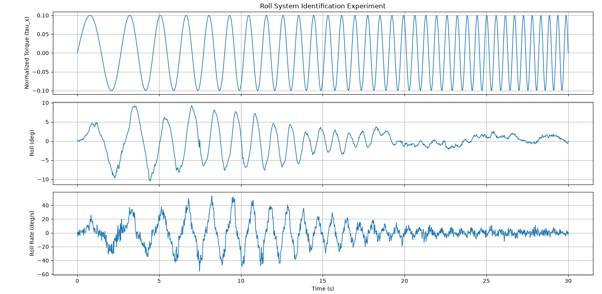

# px4-offboard-sysid

PX4 Offboard-mode experiments in Python (`pymavlink`): body-rate and actuator-level setpoints, roll-axis system identification (chirp and PRBS) with CSV logging, and a test that checks whether PX4's own control loops can be bypassed.

Developed for a bachelor's thesis on system identification and PID controller design for a Pixhawk-based quadrotor ("gimbal drone") mounted on a 3-DOF gimbal rig. Scripts were run against **PX4 v1.9.2** in SITL and AirSim HIL.

---

## Safety

- These scripts are written for **simulation** (SITL / AirSim HIL).
- `bypass_validation_test.py` is *designed* to make the vehicle diverge and tumble. Never run it on real hardware.
- Do not run any script on a real vehicle unless props are off, or it is on the gimbal rig with mechanical stops and an operator ready to cut power.
- Most scripts assume the vehicle is **already armed and flying** (taking off via QGroundControl first). Check each script's header.

---

## Contents

| Script | What it does | Connection |
|---|---|---|
| `offboard_rate_setpoints.py` | Template for Offboard control. Streams body-rate + thrust setpoints (`SET_ATTITUDE_TARGET`, attitude ignored) so PX4's rate controller tracks them. Placeholder `compute_rate_setpoint()` is where an outer-loop controller (e.g. LQR) plugs in. | SITL `:14540` |
| `roll_chirp_logger.py` | Injects a linear-sweep chirp on the roll-rate setpoint (0.3-2 Hz, 20 s) and logs `time, p_sp, phi` to CSV for offline system ID. | SITL `:14540` |
| `roll_prbs_logger.py` | Same architecture, but excites with a maximal-length PRBS (order 8) instead of a chirp. Used to cross-validate the identified model. Aborts if roll exceeds the limit. | SITL `:14540` |
| `thrust_takeoff_test.py` | Thrust-only takeoff: ramps thrust up, holds, ramps down with zero rate setpoints. Prints altitude. Used to find a working hover thrust. Arms the vehicle itself. | AirSim HIL `:14550` |
| `test_actuator_control_target.py` | Checks that the pymavlink dialect and PX4 build accept `SET_ACTUATOR_CONTROL_TARGET` in Offboard mode, using a small roll pulse. | SITL `:14540` |
| `bypass_validation_test.py` | Sends a sustained roll bias at actuator level plus base thrust and logs roll angle/rate. If the bypass is real, roll should keep diverging instead of settling. Stops at 70 deg or 15 s. | AirSim HIL `:14550` |

---

## How the Offboard scripts work

All scripts follow the same flow:

1. Connect and wait for a **PX4** heartbeat (`autopilot == 12`), ignoring other components.
2. Pre-stream setpoints. PX4 refuses the Offboard switch unless a setpoint stream is already running.
3. Switch to Offboard (`MAV_CMD_DO_SET_MODE`, custom mode 6) and confirm the `COMMAND_ACK`.
4. A background thread streams the current setpoint at 50 Hz (PX4 drops out of Offboard below about 2 Hz).
5. The main loop updates the setpoint and logs data. Ctrl+C or completion zeroes the commands and returns to position hold.

Two control levels are used:

- **Rate level** (`SET_ATTITUDE_TARGET`, type mask `0b10000000`): PX4's rate controller stays active. Used by the chirp, PRBS and takeoff scripts.
- **Actuator level** (`SET_ACTUATOR_CONTROL_TARGET`): goes to the mixer directly, skipping position, velocity, attitude and rate control. Used by the bypass tests.

---

## Requirements

- Python 3.8+
- `pymavlink`
- PX4 v1.9.2 in SITL (Gazebo) or AirSim with PX4 HIL
- QGroundControl (for manual takeoff)

```bash
pip install pymavlink
```

---

## Usage

1. Start the simulator and confirm MAVLink is reachable (UDP `14540` for SITL, `14550` for the AirSim HIL relay). Edit `CONNECTION_STRING` at the top of each script if yours differs.
2. Take off manually in QGroundControl and hover (not needed for `thrust_takeoff_test.py`).
3. Run a script:

```bash
python3 roll_chirp_logger.py
```

Suggested order for a new setup:

1. `thrust_takeoff_test.py`: find a hover thrust, then set `HOVER_THRUST` in the other scripts.
2. `offboard_rate_setpoints.py`: confirm Offboard entry and hold work.
3. `roll_chirp_logger.py`, then `roll_prbs_logger.py`: collect identification and validation data.
4. `test_actuator_control_target.py`, then `bypass_validation_test.py`: check the actuator-level path.

Edit the `CONFIG` block at the top of each script (thrust, amplitude, frequencies, safety limits).

---

## Logged data

| Script | CSV output | Columns |
|---|---|---|
| `roll_chirp_logger.py` | `roll_chirp_log.csv` | `time, p_sp, phi` |
| `roll_prbs_logger.py` | `roll_prbs_log.csv` | `time, p_sp, phi` |
| `bypass_validation_test.py` | `bypass_validation_log.csv` | `time, roll_cmd_norm, roll_meas_rad, rollspeed_meas_rad_s` |

`p_sp` is the roll-rate setpoint (rad/s) and `phi` is roll angle (rad) from PX4's `ATTITUDE` message. Processing was done offline.

---

## Example results

Roll-axis identification experiments (input, roll angle, roll rate).

**Chirp excitation** (`roll_chirp_logger.py`)



**PRBS excitation** (`roll_prbs_logger.py`)


---

## Known limitations

- Connection strings and `HOVER_THRUST` values are specific to my simulation setup. Expect to change them.
- The safety checks are simple threshold aborts, not a replacement for a real failsafe.
- `phi` comes from PX4's own estimator, not an independent sensor.
